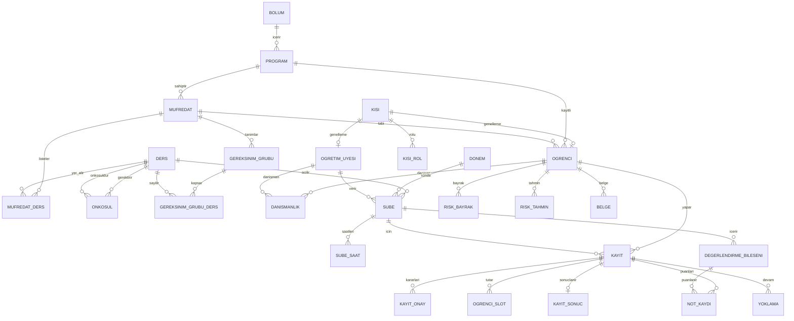

# AI Destekli Öğrenci Bilgi Sistemi (SIS) — Proje Tasarımı

**Odak:** İlişkisel veritabanı tasarımı — tablolar ve aralarındaki bağlar. İş kuralları uygulamada değil **veritabanında** (kısıt, tetikleyici, fonksiyon) durur.
**Durum:** Şema (33 tablo), kurallar, mezuniyet algoritmaları, örnek veri ve 62 test hazır; PostgreSQL 16'da çalıştırılıp test edildi.
**Platform:** masaüstü uygulaması (PySide6/Qt); terminal ekranı yok.

---

## 1. Amaç ve kapsam

Öğrenci üniversiteye zaten kayıtlıdır. Sistem; ders kaydı, danışman onayı, not, transkript ve mezuniyet takibini kurallarla yürütür, danışmana erken uyarı sinyali verir.

**Kapsam dışı:** kontenjan ve bekleme listesi, ödeme/harç, burs, staj, yurt, yatay geçiş, çift anadal, LLM tabanlı danışman.

**Bilinçli basitleştirmeler:** final taban puanı ve devamsızlık nedeniyle kalma yok; danışman süre aşımında kayıt `onay_bekliyor` kalır; What-If'te ders denkliği yok; en erken mezuniyette seçmeli açığı yok.

## 2. Benzer projelerden ortak özellikler → kararımız

| Ortak özellik (örnek kaynaklar) | Kararımız |
|---|---|
| Ders → dönemde açılan ders → şube → öğrencinin şube kaydı zinciri (Ed-Fi veri standardı; İTÜ'de şube = CRN) | `ders`, `donem`, `sube`, `kayit` |
| Kayıt kuralları: önkoşul, saat çakışması, kredi/AKTS limiti, kayıt penceresi (İTÜ, ODTÜ, Fırat OBS; açık kaynak ders kayıt projeleri) | `fn_kayit_kurallar`, `ogrenci_slot`, `akts_limit_kural`, `donem` |
| Danışman onayı, düzeltme isteği (ODTÜ, Fırat) | `kayit_onay`, `fn_danisman_karar`, durum makinesi |
| Not/transkript: harf notu katsayıları, GNO, tekrar alınan ders (OBS'ler, openSIS) | `harf_notu_aralik`, `v_gecerli_sonuc`, `fn_gno` |
| Mezuniyet denetimi: gereksinim grupları, seçmeli havuz asgarileri, çift sayım (DegreeWorks, Cornell CoursePlan, Fırat/Atatürk örnekleri) | `gereksinim_grubu`, `gereksinim_grubu_ders` |
| Roller ve yetki (AlekSIS, openSIS) | `kisi_rol`, `danismanlik` (+ satır düzeyi güvenlik, sonraki aşama) |
| Değişiklik geçmişi (SmartCourse'ta yönetici günlükleri) | `denetim_log` (hash zinciri) |
| Erken uyarı (Georgia State GPS, OAAI, OU Analyse) | `risk_kural`, `risk_bayrak`, `risk_tahmin` |
| Haftalık ders programı | `sube_saat` |

## 3. Mimari

```
PySide6 masaüstü uygulaması (giriş + 6 ekran, iş kuralı YOK)
   └─ app/db.py: psycopg bağlantıları; uzun işler ayrı iş parçacığında, ayrı bağlantıyla
        └──► PostgreSQL (kurallar, kısıtlar, log)
Python AI betikleri (scikit-learn) ──► risk_bayrak / risk_tahmin tabloları
```

Prensipler: (1) kural veritabanında; (2) uygulama tabloya doğrudan yazmaz, fonksiyon çağırır; (3) yönetmelik değerleri parametre tablolarında; (4) kritik her değişiklik loglanır; (5) arayüz ince kalır, hata kodlarını (`ONKOSUL_EKSIK`, `CAKISMA`, `AKTS_ASIMI` ...) kullanıcı dilinde mesaja çevirir.

## 4. Veri modeli

### 4.1 ER diyagramı (GitHub'da otomatik çizilir)



### 4.2 Tablo grupları (33 tablo)

- **Parametre:** `harf_notu_aralik`, `akts_limit_kural`, `parametre`, `kayit_gecis`
- **Akademik yapı:** `bolum`, `program`, `mufredat`, `ders`, `mufredat_ders`, `onkosul`, `gereksinim_grubu`, `gereksinim_grubu_ders`
- **Kişiler:** `kisi` (genelleme) → `ogrenci`, `ogretim_uyesi`; `kisi_rol`, `danismanlik`
- **Dönem/şube:** `donem`, `sube`, `sube_saat`
- **Kayıt/not:** `kayit`, `kayit_onay`, `ogrenci_slot`, `degerlendirme_bileseni`, `not_kaydi`, `kayit_sonuc`, `yoklama`
- **Denetim/belge/risk:** `denetim_log`, `belge`, `risk_kural`, `risk_bayrak`, `model_surum`, `risk_tahmin`

### 4.3 Bağları sağlam tutan teknikler (rapor için en önemli kısım)

| Teknik | Nerede | Ne garanti eder |
|---|---|---|
| Bileşik yabancı anahtar | `kayit (sube_id, ders_id, donem_id) → sube` | Kaydın ders/dönem bilgisi şubeyle çelişemez |
| İki bileşik yabancı anahtar | `not_kaydi` | Puanın bileşeni ile kaydın şubesi aynı olmak zorunda |
| Kısmi UNIQUE indeks | `ux_kayit_aktif` | Aynı dönem aynı dersin iki aktif şubesi olamaz |
| Birincil anahtar ile çakışma | `ogrenci_slot` | Aynı saat diliminde iki ders olamaz (eşzamanlı isteklerde de) |
| EXCLUDE | `danismanlik`, `akts_limit_kural` | Tek aktif danışman; GNO aralıkları çakışmaz |
| Durum geçiş tablosu + tetikleyici | `kayit_gecis` | Yalnız izinli durum geçişleri |
| Ertelenebilir kısıt | `ctrg_bilesen_agirlik` | Bileşen ağırlıkları işlem sonunda 100 |
| Satır kilidi | `fn_kayit_kurallar` | Eşzamanlı kesinleştirmede AKTS limiti aşılmaz |
| Hash zinciri + yazma yasağı | `denetim_log` | Log oynaması ele verilir; UPDATE/DELETE/TRUNCATE yasak |
| Recursive CTE | `fn_onkosul_dongu` | Önkoşul grafı döngüsüz (DAG) kalır |

## 5. Uygulanan kurallar (`sql/002_kurallar.sql`)

- Kayıt yalnız dönemin kayıt penceresinde kesinleştirilir; onaylı dersi bırakma ekle-bırak penceresiyle sınırlı (`DONEM_KAPALI`)
- Önkoşul, gerekli minimum notla geçilmeden ders alınamaz (`ONKOSUL_EKSIK`); önkoşul grafında döngü yasak
- Saat çakışması reddedilir (`CAKISMA`); aynı dönem aynı dersin ikinci şubesi reddedilir
- Dönemlik AKTS, GNO'ya göre değişen sınırı aşamaz (`AKTS_ASIMI`)
- Kayıt durumu yalnız izinli geçişlerle değişir (`GECERSIZ_GECIS`); sepet → onay bekliyor → onaylı / reddedildi / bırakıldı
- Onay/red yalnızca öğrencinin güncel danışmanı verebilir (`YETKISIZ`); red ve düzeltme isteği gerekçe ister
- Not bileşen ağırlıkları toplamı 100 olmalı; harf notu puandan hesaplanır, elle girilmez
- GNO: AKTS ağırlıklı; tekrar alınan derste hangi sonucun sayılacağı parametrede (`son` / `en_yuksek`)
- Kritik tablolardaki her değişiklik hash zincirli, değiştirilemez denetim loguna yazılır

## 6. Algoritmalar

**Uygulandı ve test edildi:** önkoşul denetimi (+ döngü koruması), çakışma, AKTS limiti + kilit, GNO ve geçerli sonuç seçimi, not → harf hesabı, danışman onayı akışı, denetim zinciri ve (`sql/004_mezuniyet.sql`):
- **`fn_mezuniyet_denetim`:** geçilen dersleri gereksinim gruplarına öncelik sıralı açgözlü eşleştirir; `cift_sayim = false` olan grup seçtiği dersleri tüketir. Kesin çözüm zor bir problem olduğu için gerçek denetim sistemleri de sezgisel eşleştirme kullanır. İkinci parametre **What-If** sağlar (aynı öğrenci başka müfredata karşı denetlenir; ders kataloğunun ortak olduğu varsayılır).
- **`fn_mezuniyet_ozet`:** toplam AKTS + GNO eşiği + gruplar → `mezuniyet_uygun`.
- **`fn_ders_plani`:** kalan zorunlu dersleri önkoşul ve AKTS limitine göre dönemlere dağıtır (kritik yol önceliğiyle açgözlü planlama). Önkoşulu yetersiz notla geçilmiş ders tekrar planlanır.
- **`fn_en_erken_mezuniyet`:** önkoşul grafında en uzun yol = en az dönem sayısı; AKTS limitiyle gerçek dönem sayısı. Sınırlama: yalnızca zorunlu dersleri planlar, seçmeli açığını hesaba katmaz.

**Sıradaki:**
- **Risk bayrakları:** SQL view'ları (GNO eşiği, zorunlu derste FF, devamsızlık, AKTS gerisi, önkoşul blokajı).
- **Risk skoru:** scikit-learn; OULAD ile eğitilir, yalnızca iki tarafta da hesaplanabilen özellikler kullanılır; demografik alanlar özellik olmaz; sonuç `risk_tahmin` tablosuna model sürümü ve özellikleriyle yazılır.

## 7. AI katmanı

1. Kural tabanlı bayraklar (SQL) + açıklanabilir risk skoru (lojistik regresyon → gradyan artırma). Karar vermez; yalnız danışmana gösterilir.
2. Opsiyonel: ders seçiminde tahmini not (geçmiş sonuçlardan).
3. Opsiyonel: not değişikliği anomali tespiti (denetim logu üzerinde).

Sınırlılık: sentetik veride model yalnızca üretim kurallarını öğrenir; gerçek doğrulama OULAD üzerinde yapılır ve raporda ayrı yazılır.

## 8. Ekranlar (giriş + 6) ve yetki

Yerleşim (İTÜ OBS gibi): solda menü (`QListWidget`), sağda sayfalar (`QStackedWidget`). Tablolar için `QTableView` + `QAbstractTableModel`; haftalık program ızgarası `QTableWidget` (12 ders saati × gün, `sube_saat` ile birebir).

0. **Giriş:** demo için kullanıcı seçimi (öğrenci / danışman / öğretim üyesi / sekreter / yönetici); seçilen kullanıcı kimliği veritabanına her işlemde bildirilir (satır düzeyi güvenliğin temeli)

1. **Ana sayfa:** sınıf, AKTS, DNO/GNO kartları, dönem çizelgesi (öğrenci)
2. **Ders seçimi:** arama, sepet, haftalık takvim önizlemesi, Kontrol Et → Kesinleştir, durum sekmeleri (öğrenci)
3. **Notlar/transkript** (öğrenci; danışman kendi danışanlarını görür)
4. **Mezuniyetime Ne Kaldı?** (öğrenci, danışman)
5. **Danışman paneli:** onay kuyruğu, riskli danışanlar (danışman)
6. **Yönetim/Demo:** parametreler, denetim logu, eşzamanlılık demosu (yönetici, sekreter)

## 8.1 Demolar (hoca için)

Demolar terminalden değil, uygulamadaki **Demo sayfasından butonla** çalışır: her eşzamanlı işlem kendi iş parçacığında ve kendi veritabanı bağlantısıyla koşar, sonuçlar canlı bir tabloda görünür. Çökme/kurtarma demosu uygulamadan yapılamaz (veritabanı sunucusunun durdurulması gerekir); nasıl gösterileceği hocaya sorulmalı.


| Demo | Durum |
|---|---|
| **AKTS yarışı:** `akts_kilidi='kapali'` iken iki eşzamanlı kesinleştirme limiti aşar (ölçüm: dönemlik AKTS 36 > 30); `'acik'` iken biri `AKTS_ASIMI` ile reddedilir (ölçüm: 30) | İki ayrı bağlantıyla denendi |
| **Kilitlenme:** iki işlem iki kaydı ters sırada günceller → `deadlock detected`; çözüm: kilitleri hep aynı sırada al | Planlandı |
| **Silinen notu geri alma:** yedekten geri dönüş (+ denetim logu ile kimin sildiği) | Planlandı |
| **İndeks öncesi/sonrası:** büyük `kayit`/`not_kaydi` verisinde EXPLAIN ANALYZE | Planlandı |

## 9. Teknoloji

PostgreSQL 16+, Python, **PySide6 (Qt 6)**, **psycopg 3**, scikit-learn; paketleme PyInstaller (`--windowed`, terminal penceresiz). Veritabanı seçimi hoca onayına tabi.

**Neden PySide6:** Qt, C++ bilen biri için tanıdık (sinyal/slot, layout); proje tablo ağırlıklı ve Qt'de tablo/model-görünüm hazır; arka plan iş parçacıklarıyla eşzamanlılık demosu doğal; PyInstaller ile çift tıklanan uygulama çıkar.

**Neden QtSql değil psycopg:** Qt'nin PostgreSQL sürücüsü (QPSQL) sistemdeki PostgreSQL istemci kütüphanelerine dayanır; paketlenmiş uygulamada "driver not loaded" hatası sık görülür. `psycopg[binary]` kendi kütüphanesini getirir, bu yüzden bağlantı `psycopg` ile, tablo gösterimi özel `QAbstractTableModel` ile yapılır.

**Önerilen klasör yapısı:** `app/main.py`, `app/db.py` (bağlantı, fonksiyon çağrıları, hata kodu → mesaj), `app/ekranlar/` (giriş, ana sayfa, ders seçimi, notlar, mezuniyet, danışman, yönetim/demo), `app/modeller.py` (tablo modelleri).

**Demo bilgisayarı:** PostgreSQL kurulu olmalı; uygulama yalnızca bağlantı bilgisini (`.env`) okur.

**Oracle'a geçersen:** `jsonb` → JSON; `daterange`/EXCLUDE → tetikleyici (çakışma zaten `ogrenci_slot` birincil anahtarıyla DBMS-bağımsız çözülüyor); `FOR UPDATE SKIP LOCKED` Oracle'da da var; Flashback Query (`AS OF TIMESTAMP`) "silinen notu geri alma" demosunu kolaylaştırır. Ücretsiz sürüm sınırları: 2 CPU, 2 GB RAM, 12 GB kullanıcı verisi.

## 10. Çalıştırma

```
createdb obs
psql -d obs -f sql/001_sema.sql
psql -d obs -f sql/002_kurallar.sql
psql -d obs -f sql/003_ornek_veri.sql      # süper kullanıcı ile
psql -d obs -f sql/004_mezuniyet.sql
psql -d obs -f tests/001_testler.sql       # 42 test, çıktı: PASS / FAIL
psql -d obs -f tests/002_mezuniyet_testleri.sql   # 20 test
```

Uygulama (sonraki aşama): `pip install PySide6 "psycopg[binary]"` sonra `python app/main.py`; paketlemek için `pyinstaller --windowed app/main.py`.

`003` dosyasındaki harf notu katsayıları, AKTS limitleri ve tüm kişi/ders verileri **örnektir**; gerçek değerleri Fırat Üniversitesi yönetmeliğinden alıp parametre tablolarına yaz.

## 11. Yol haritası

Ayrıntılı plan: `UYGULAMA_PLANI.md` (aşamalar A–H) · API ve ekranlar: `VERITABANI_API_VE_EKRANLAR.md` · rapor: `RAPOR_ISKELETI.md`.

- [x] Şema (33 tablo), kurallar, örnek veri, 62 test
- [ ] Hocaya sor: DBMS, çökme/kurtarma demosunun nasıl gösterileceği, teslim aşamaları, yapay zekâ yardımı politikası (arayüz kararı verildi: masaüstü)
- [x] Mezuniyet denetimi, What-If, ders planı, en erken mezuniyet (`004_mezuniyet.sql`)
- [ ] Risk bayrakları (SQL view'ları)
- [ ] PySide6 uygulaması: `db.py` + giriş + 6 ekran + Demo sayfası
- [ ] PyInstaller ile paketleme (terminal penceresiz)
- [ ] Risk skoru (OULAD) ve `risk_tahmin` yazımı
- [ ] Satır düzeyi güvenlik (öğrenci/danışman/öğretim üyesi görünürlüğü)
- [ ] Rapor (bu belgedeki başlıklar iskelet olarak kullanılabilir)
